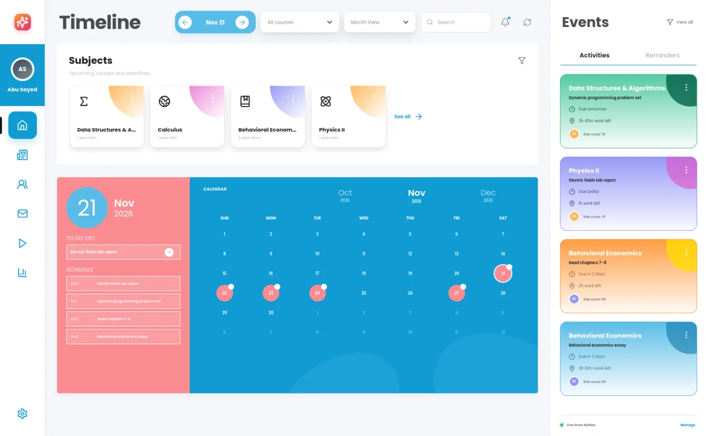
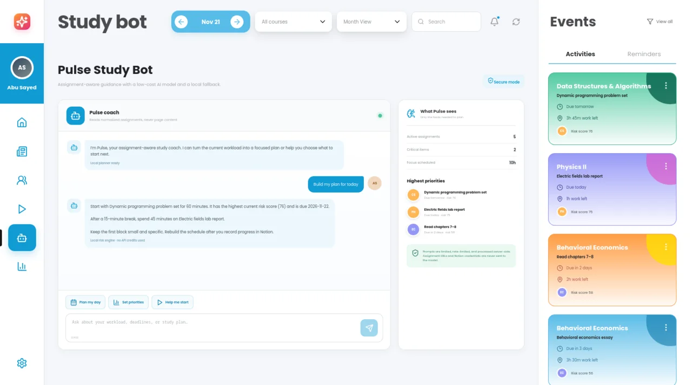

# PulsePlan



**Your Notion Student OS, now proactive.**

PulsePlan reads assignments from Notion, explains which deadlines are becoming risky, and creates a realistic seven-day study plan that respects daily capacity. The included demo workspace makes every feature testable without credentials.

> Built for the Cognition × Notion Student OS Hackathon.

**Live demo:** [pulseplan-student-os-076ade555e28.herokuapp.com](https://pulseplan-student-os-076ade555e28.herokuapp.com/)

## The problem

A Student OS is excellent at storing classes, assignments, and deadlines. A busy student still has to answer a harder question every day: **what should I work on now, and will everything fit before it is due?**

A due-date sort cannot account for a large assignment due in three days versus a short assignment due tomorrow. Students often discover overload only after there is no room left to recover.

## What PulsePlan does

- **Reads Student OS assignments** through Notion's current data-source API.
- **Calculates a transparent risk score** from urgency, remaining workload, priority, and whether work has started.
- **Builds a seven-day plan** with 15–60 minute focus blocks, daily capacity limits, protected breaks, and a two-hour daily limit per assignment.
- **Flags impossible weeks early** by showing work that cannot fit before its deadline.
- **Writes focus blocks back to Notion** as Study Session pages.
- **Adds an assignment-aware Study Bot** that can plan the day, rank priorities, and turn a difficult assignment into a concrete first step.
- **Uses `gpt-4o-mini` when configured** and automatically falls back to the local risk engine without consuming API credits.
- **Exports the plan to CSV** when write-back is not configured.
- **Runs in demo mode automatically**, so judges can evaluate the complete workflow without access to a private workspace.

## How it improves Notion Student OS

PulsePlan complements the hackathon [Student OS workspace](https://app.notion.com/p/campusleaders/Student-OS-Build-Your-Campus-Life-with-Notion-41cd5368c6db80da906ec73c061b3cc6?source=copy_link). Notion remains the source of truth. PulsePlan adds a decision layer:

```text
Student OS Assignments → normalize → risk score → capacity-aware plan → Study Bot → Study Sessions in Notion
```

The adapter auto-detects common names such as `Name`, `Assignment`, `Due`, `Deadline`, `Course`, `Class`, `Status`, `Priority`, `Estimated hours`, and `Progress`. It follows Course relations to display the related page title. Environment variables can override every mapping, so the app does not depend on one exact template schema.

For the live hackathon workspace, the official Notion CLI provisioned a separate **PulsePlan Student OS** dashboard with the guide's four core databases, Courses, Assignments, Notes, and Tasks. It also added the Study Sessions write-back database, Courses ↔ Assignments and Courses ↔ Notes relations, realistic sample rows, and a verified live focus session.

## Demo workflow

1. Open **Timeline** to see live Notion courses, deadlines, the selected-day agenda, and upcoming events.
2. Change the month or week, select a calendar date, filter by course, and search assignments.
3. Open **Assignments** to inspect risk-ranked work and progress.
4. Open **Courses** to compare each subject's current workload.
5. Open **Study plan**, change daily capacity, complete a focus block, export CSV, or sync the plan to Notion.
6. Open **Study bot** and ask for a daily plan, priority ranking, or a concrete first step.
7. Open **Notion setup** to inspect live connection and write-back status.

The interface follows the supplied Student Activities dashboard reference: a cyan icon rail, Timeline toolbar, subject cards, coral agenda, interactive blue calendar, and gradient activity panel.

## How Devin Chat was used

I used Devin Chat for a final review of the completed repository and spent the hackathon-provided Devin credits on that review. Devin's role was to examine the project before submission rather than to replace the product decisions or validation work.

After the Devin review, I independently verified the implementation by:

- Running the TypeScript planner and Notion normalization tests.
- Building the production Next.js application.
- Exercising every desktop and mobile view in Firefox.
- Testing course filters, search, date controls, calendar modes, reminders, capacity changes, and session completion.
- Testing both demo API behavior and live Notion reads, validation, and Study Session write-back.
- Checking that no Notion credential was committed or exposed to the browser.

The implementation history and human decisions remain visible in the Git commit history. Additional review notes are recorded in [`DEVIN_USAGE.md`](./DEVIN_USAGE.md).

## Run locally

### Requirements

- Node.js 20.9 or later
- npm
- A Notion integration only if live sync is needed

### Demo mode

```bash
git clone https://github.com/Sayed-47/pulseplan-student-os.git
cd pulseplan
npm install
npm run dev
```

Open [http://localhost:3000](http://localhost:3000). No environment file is required.

### Live Notion mode

1. Create a Notion internal integration with **Read content**. Add **Insert content** for write-back.
2. Share the Assignments and Study Sessions data sources with the integration through Notion's **Connections** menu.
3. Copy the example environment file:

```bash
cp .env.example .env.local
```

4. Set at least these values:

```dotenv
NOTION_API_KEY=ntn_your_secret
NOTION_ASSIGNMENTS_DATA_SOURCE_ID=your_assignments_data_source_id
NOTION_SESSIONS_DATA_SOURCE_ID=your_study_sessions_data_source_id
```

5. Restart `npm run dev`.

The token is read only in server routes. It is never included in browser JavaScript or API responses.

### Study Bot configuration



The Study Bot works without an AI key by using PulsePlan's deterministic risk engine. To enable short AI-generated coaching, add a dedicated OpenAI API key:

```dotenv
OPENAI_API_KEY=sk-your-dedicated-key
OPENAI_MODEL=gpt-4o-mini
OPENAI_BASE_URL=https://api.openai.com/v1
```

`gpt-4o-mini` is used to limit cost. The server sends at most 20 normalized assignments and excludes Notion URLs, page content, and credentials.

Security controls include:

- Same-origin POST enforcement
- JSON-only requests and a 2 KB body limit
- A 400-character prompt limit
- Eight requests per IP every ten minutes
- A 20-second provider timeout
- A fixed system instruction that treats assignment fields as untrusted data
- A 450-token response limit
- Sanitized provider errors and automatic local fallback

If a credential has been pasted into chat, logs, or source control, rotate it before use. Configure production keys directly through the hosting provider's secret settings.

### Recommended Notion properties

**Assignments**

| Property | Type | Required |
|---|---|---:|
| Name | Title | Yes |
| Due | Date | Yes |
| Status | Status or Checkbox | No |
| Course | Relation, Select, or Text | No |
| Estimated hours | Number | No |
| Priority | Select | No |
| Progress | Number (`0–1` or `0–100`) | No |

When an estimate is missing, PulsePlan uses three hours for high-priority work and two hours for other work.

**Study Sessions**

| Property | Type | Required |
|---|---|---:|
| Name | Title | Yes |
| Date | Date | Yes |
| Course | Select or Text | No |
| Duration | Number (minutes) | No |
| Status | Status, Select, or Checkbox | No |
| Source | URL or Text | No |

All names can be changed through `.env.local`; see [`.env.example`](./.env.example).

## Risk model

The score is deterministic and capped at 100:

| Signal | Maximum | Mechanism |
|---|---:|---|
| Deadline urgency | 48 | Rises as the due date approaches; overdue work gets the maximum. |
| Workload pressure | 26 | Remaining hours divided by available days. |
| Priority | 22 | High, medium, and low map to 22, 13, and 6 points. |
| Starting inertia | 8 | Adds pressure when near-term work has not started. |

- `70–100`: act now
- `45–69`: at risk
- `0–44`: on track
- Completed work always scores `0`.

## Architecture

```text
app/
  api/assignments/route.ts   Notion read endpoint with safe demo fallback
  api/study-coach/route.ts   Rate-limited OpenAI-compatible coaching endpoint
  api/sync/route.ts          Validated Study Session write-back
components/Dashboard.tsx     Responsive Timeline, courses, planner, Study Bot, and setup UI
lib/
  notion.ts                  API 2026-03-11 adapter and schema mapping
  planner.ts                 Pure scoring and scheduling engine
  study-coach.ts             Input validation, minimized context, and local fallback
  demo-data.ts               Date-relative judge demo
```

Notable implementation choices:

- The planner is a pure TypeScript function, which makes it fast and testable.
- Notion failures fall back to demo data with a visible warning instead of breaking the presentation.
- Writes are validated and capped at 100 sessions per request.
- Notion tokens and AI keys remain server-side.
- The Study Bot works without an AI key and restricts configured models to low-cost options.

## Verification

| Layer | Result | Coverage |
|---|---:|---|
| Unit tests | 14 passed | Risk scoring, scheduling constraints, Notion normalization, coach validation, context minimization, and fallback behavior |
| Browser E2E | 25 passed | All six views, desktop/mobile navigation, filters, date controls, reminders, calendar, planner, and Study Bot interactions |
| Study Bot API | Passed | Local fallback, OpenAI transport mock, low-cost model selection, same-origin enforcement, body and prompt limits, rate limiting, and secret minimization |
| Production build | Passed | Next.js compilation, TypeScript, static generation, and API routes |
| Heroku smoke test | Passed | Homepage HTTP 200, demo assignments response, and protected write endpoint |
| Live Notion test | Passed | Six assignment reads, four Course relations, input validation, Study Session creation, and cleanup |
| Security check | Passed | `.env.local` ignored and no Notion token tracked by Git |

Run the repeatable local checks:

```bash
npm test
npm run lint
npm run build
```

The temporary browser test environment and live write probe are not committed because they depend on local Firefox and private Notion credentials.

## Deploy

The public demo is deployed on Heroku:

- [https://pulseplan-student-os-076ade555e28.herokuapp.com/](https://pulseplan-student-os-076ade555e28.herokuapp.com/)
- Region: EU
- Stack: Heroku-24
- Process: `web: npm start`

The deployment runs in demo mode unless dedicated Notion integration credentials are added through Heroku Config Vars. Do not deploy a broad personal Notion CLI token.

You can also deploy through Vercel:

1. Import the public GitHub repository.
2. Keep all environment variables blank for a public demo, or add the Notion variables in project settings for live mode.
3. Deploy with the default Next.js settings.

Do not commit `.env.local` or expose a Notion token in screenshots.

## Hackathon submission checklist

- [x] Run the project and verify all six navigation sections.
- [x] Use Devin Chat for a real final review and document it above.
- [x] Add the final public GitHub URL to this README.
- [x] Push the repository publicly.
- [ ] Submit your full name, Luma-registered email, and direct repository URL through the official form before 6:00 PM.

## Documentation references

- [Hackathon Student OS workspace](https://app.notion.com/p/campusleaders/Student-OS-Build-Your-Campus-Life-with-Notion-41cd5368c6db80da906ec73c061b3cc6?source=copy_link)
- [Notion: Query a data source](https://developers.notion.com/reference/query-a-data-source)
- [Notion: Create a page](https://developers.notion.com/reference/post-page)
- [Notion: Connections and capabilities](https://developers.notion.com/reference/capabilities)
- [OpenAI: GPT-4o mini model](https://platform.openai.com/docs/models/gpt-4o-mini)
- [OpenAI API reference](https://developers.openai.com/api/reference)

Documentation details were summarized and rephrased for licensing compliance.

## License

[MIT](./LICENSE)
